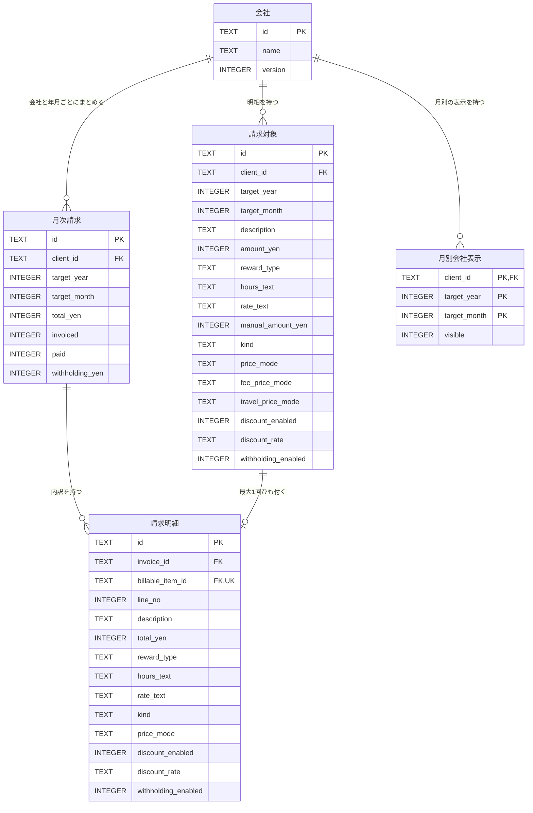
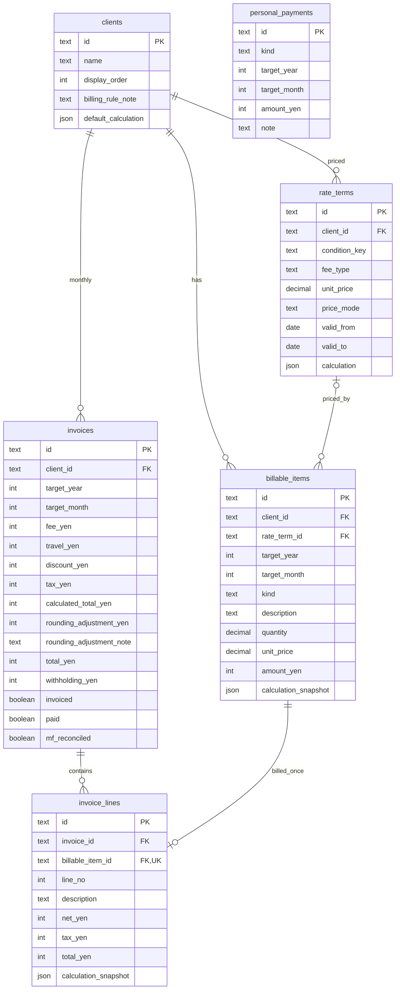

# 請求管理システム ER図とデータ設計

版：0.17 S16の既存DBからの年間読取を反映（DB版9を維持）　更新日：2026年11月3日

対象ブランチ：`main`（開発用MVP 3作業ツリーから作成した公開用スナップショット）／確認日：2026年11月3日／スキーマ：`PRAGMA user_version=9`。
実装範囲：S01〜S16・S23・S27・S28・S30・S31・S35のコード反映範囲。S16・S23・S27・S30・S35はDB構造の変更を伴わない。S35の税込金額と値引きの負号は表示処理であり、保存列や計算値を変更しない。S16は既存請求の登録有無と各月の明細・源泉額・チェックを一つの読取トランザクションで参照し、月次と同じ計算後に年間へ合算する。年間集計専用の保存列・テーブルは追加しない。完了・レビュー待ちの状態は[仕様管理](仕様管理.md)を正本とする。コード反映と検証・ユーザーレビュー後の受入完了は区別する。

本書はDB資料の唯一の正本。現行は5テーブル・46列・5関連で、001〜009のマイグレーションを空の検証用DBへ適用し、構造・制約・索引を照合した。既存のローカルDB・実データは今回の照合に使っていない。要件と受入条件の正本は[要求仕様書](要求仕様書.md)。

[ER概要図](ER概要図.svg)・[テーブル別閲覧](ER閲覧.html)・[期間選択の参照範囲図](S01対象期間とER.svg)は、本書の現行定義から生成する補助表示。版9の5表を表示し、期間参照図は年月と参照に必要な項目だけを抜粋する。再生成は `python3 docs/diagrams/build-er-viewer.py`。将来設計は本書末尾に分け、現行の図へ混ぜない。

## 1. 現行のER図

`||`＝必ず1件、`o|`＝0または1件、`o{`＝0件以上。会社×対象年月で月次請求を1件にまとめ、請求対象は最大1つの請求明細へ関連付ける。年度・月の選択状態は画面内・URL・ブラウザ履歴で持ち、選択中の期間専用テーブルは作らない（S23）。S31の月別表示設定は選択中の画面状態と区別し、会社・対象年月の永続データとして保存する。未保存入力は画面内だけに保持する。



## 2. 現行テーブルの役割

| テーブル | 役割 |
|---|---|
| client_month_visibility 月別会社表示 | 会社・対象年月ごとの表示ON/OFF。明細0件でも保存し、請求や会社削除と独立して扱う。 |
| clients 会社 | 会社名と全社保存の競合検出用の更新番号。年度をまたぐ共通マスタ。 |
| billable_items 請求対象 | 会社・対象年月ごとの業務内容と金額、報酬・交通費・立替経費、入力条件と切替前の値。 |
| invoices 月次請求 | 会社・対象年月で1件。源泉控除前の小計、手入力の源泉額、請求済・入金済。 |
| invoice_lines 請求明細 | 月次請求と請求対象の対応、0から始まる順序、当時の内容・金額・計算条件の写し。 |

## 3. 物理項目定義

型・NULL可否・既定値はSQLiteの定義そのものを示す。既定値の「なし」はDEFAULT句なし、`''`は空文字。4表の`id TEXT PRIMARY KEY`には明示のNOT NULLがなく、SQLiteの通常のrowid表ではNULLを許す。画面・APIは空でないIDを要求する。この相違は制約を修正せず資料へ記録した。整数・文字列の入力範囲等をAPIでも検証する。

保存用の既定値は既存データの移行を成立させる値であり、新規入力の初期値とは区別する。新規報酬の税区分は税抜、新規交通費・立替経費は税込。値引き率は対象月が2026年10月以降なら2％、以前なら1.3％。既存明細の移行条件は[DB移行と復元](DB移行と復元.md)を参照。

### client_month_visibility（月別会社表示）

| 列名 | 型 | NULL可否 | 既定値 | 内容 |
|---|---|---|---|---|
| client_id | TEXT | 不可 | なし | 会社ID。対象年・月との複合主キーと外部キー |
| target_year | INTEGER | 不可 | なし | 西暦の対象年（1〜9999）。複合主キー |
| target_month | INTEGER | 不可 | なし | 対象月（1〜12）。複合主キー |
| visible | INTEGER | 不可 | `0` | 表示ON/OFF（1／0）。設定なしは当月入力の保護から判定し、GETでは設定を作らない |

### clients（会社）

| 列名 | 型 | NULL可否 | 既定値 | 内容 |
|---|---|---|---|---|
| id | TEXT | 可 | なし | 識別ID。APIで空でない文字列を必須とする |
| name | TEXT | 不可 | なし | 会社名 |
| version | INTEGER | 不可 | `0` | 全社保存の競合検出。更新ごとに加算 |

### billable_items（請求対象）

| 列名 | 型 | NULL可否 | 既定値 | 内容 |
|---|---|---|---|---|
| id | TEXT | 可 | なし | 識別ID。APIで空でない文字列を必須とする |
| client_id | TEXT | 不可 | なし | 会社ID |
| target_year | INTEGER | 不可 | なし | 西暦の対象年 |
| target_month | INTEGER | 不可 | なし | 対象月（1〜12） |
| description | TEXT | 不可 | なし | 業務内容・明細名 |
| amount_yen | INTEGER | 不可 | なし | 区分に従う入力金額。調整だけ負額可。時給では明細ごとに円未満切り上げ後の金額 |
| reward_type | TEXT | 不可 | `'per_item'` | per_item（案件単価）／hourly（時給）。交通費・立替経費・調整でもper_itemを保存 |
| hours_text | TEXT | 不可 | `''` | 小数時間を入力どおり保持。分へ換算しない |
| rate_text | TEXT | 不可 | `''` | 時間単価の十進数文字列 |
| manual_amount_yen | INTEGER | 可 | なし | タイプ往復時に復元する以前の手入力額。調整へ戻す負額も保持 |
| kind | TEXT | 不可 | `'fee'` | fee（報酬）／travel（交通費）／expense（立替経費）／adjustment（調整） |
| price_mode | TEXT | 不可 | `'inclusive'` | inclusive（税込）／exclusive（税抜） |
| fee_price_mode | TEXT | 不可 | `'inclusive'` | 報酬へ戻したときの税区分 |
| travel_price_mode | TEXT | 不可 | `'inclusive'` | 交通費・立替経費で共通の復元用税区分 |
| discount_enabled | INTEGER | 不可 | `0` | 報酬の値引き有無（0／1）。交通費・立替経費の間も復元用に保持 |
| discount_rate | TEXT | 不可 | `'2'` | 値引き率（％）。適用しないときは空文字も許容 |
| withholding_enabled | INTEGER | 不可 | `0` | 源泉有無（0／1）。交通費・立替経費の間は対象外として元の選択を保持 |

### invoices（月次請求）

| 列名 | 型 | NULL可否 | 既定値 | 内容 |
|---|---|---|---|---|
| id | TEXT | 可 | なし | 識別ID。APIで空でない文字列を必須とする |
| client_id | TEXT | 不可 | なし | 会社ID |
| target_year | INTEGER | 不可 | なし | 西暦の対象年 |
| target_month | INTEGER | 不可 | なし | 対象月（1〜12） |
| total_yen | INTEGER | 不可 | なし | 月次請求では税・値引き後に調整額を加減した、源泉控除前の小計。請求明細では区分に従う当時の入力金額 |
| invoiced | INTEGER | 不可 | なし | 請求済（0／1） |
| paid | INTEGER | 不可 | なし | 入金済（0／1） |
| withholding_yen | INTEGER | 不可 | `0` | MFで計算した源泉額の手入力。小計から引く前の独立した金額 |

### invoice_lines（請求明細）

| 列名 | 型 | NULL可否 | 既定値 | 内容 |
|---|---|---|---|---|
| id | TEXT | 可 | なし | 識別ID。APIで空でない文字列を必須とする |
| invoice_id | TEXT | 不可 | なし | 月次請求ID |
| billable_item_id | TEXT | 不可 | なし | 請求対象ID。同じ対象は最大1つの請求明細へ関連 |
| line_no | INTEGER | 不可 | なし | 0から始まる明細の順序 |
| description | TEXT | 不可 | なし | 業務内容・明細名 |
| total_yen | INTEGER | 不可 | なし | 月次請求では税・値引き後に調整額を加減した、源泉控除前の小計。請求明細では区分に従う当時の入力金額 |
| reward_type | TEXT | 不可 | `'per_item'` | per_item（案件単価）／hourly（時給）。交通費・立替経費・調整でもper_itemを保存 |
| hours_text | TEXT | 不可 | `''` | 小数時間を入力どおり保持。分へ換算しない |
| rate_text | TEXT | 不可 | `''` | 時間単価の十進数文字列 |
| kind | TEXT | 不可 | `'fee'` | fee（報酬）／travel（交通費）／expense（立替経費）／adjustment（調整） |
| price_mode | TEXT | 不可 | `'inclusive'` | inclusive（税込）／exclusive（税抜） |
| discount_enabled | INTEGER | 不可 | `0` | 報酬の値引き有無（0／1）。交通費・立替経費の間も復元用に保持 |
| discount_rate | TEXT | 不可 | `'2'` | 値引き率（％）。適用しないときは空文字も許容 |
| withholding_enabled | INTEGER | 不可 | `0` | 源泉有無（0／1）。交通費・立替経費の間は対象外として元の選択を保持 |

## 4. DB制約と索引

以下は空DBに001〜009を適用した後の`sqlite_master`のCREATE TABLE定義。CHECK・NOT NULL・DEFAULT・参照先・一意制約はこの定義と照合する。外部キーの更新・削除アクションはいずれもNO ACTION。接続時はforeign_keysを有効化する。

```sql
CREATE TABLE clients (
  id TEXT PRIMARY KEY,
  name TEXT NOT NULL,
  version INTEGER NOT NULL DEFAULT 0
);
```

```sql
CREATE TABLE billable_items (
  id TEXT PRIMARY KEY,
  client_id TEXT NOT NULL REFERENCES clients(id),
  target_year INTEGER NOT NULL,
  target_month INTEGER NOT NULL,
  description TEXT NOT NULL,
  amount_yen INTEGER NOT NULL CHECK((amount_yen>=0 OR kind='adjustment') AND (kind<>'adjustment' OR amount_yen BETWEEN -999999999 AND 999999999)),
  reward_type TEXT NOT NULL DEFAULT 'per_item' CHECK(reward_type IN('per_item','hourly')),
  hours_text TEXT NOT NULL DEFAULT '',
  rate_text TEXT NOT NULL DEFAULT '',
  manual_amount_yen INTEGER CHECK(manual_amount_yen IS NULL OR manual_amount_yen BETWEEN -999999999 AND 999999999),
  kind TEXT NOT NULL DEFAULT 'fee' CHECK(kind IN('fee','travel','expense','adjustment')),
  price_mode TEXT NOT NULL DEFAULT 'inclusive' CHECK(price_mode IN('inclusive','exclusive')),
  fee_price_mode TEXT NOT NULL DEFAULT 'inclusive' CHECK(fee_price_mode IN('inclusive','exclusive')),
  travel_price_mode TEXT NOT NULL DEFAULT 'inclusive' CHECK(travel_price_mode IN('inclusive','exclusive')),
  discount_enabled INTEGER NOT NULL DEFAULT 0 CHECK(discount_enabled IN(0,1)),
  discount_rate TEXT NOT NULL DEFAULT '2',
  withholding_enabled INTEGER NOT NULL DEFAULT 0 CHECK(withholding_enabled IN(0,1))
);
```

```sql
CREATE TABLE invoices (
  id TEXT PRIMARY KEY,
  client_id TEXT NOT NULL REFERENCES clients(id),
  target_year INTEGER NOT NULL CHECK(target_year BETWEEN 1 AND 9999),
  target_month INTEGER NOT NULL CHECK(target_month BETWEEN 1 AND 12),
  total_yen INTEGER NOT NULL CHECK(total_yen>=0),
  invoiced INTEGER NOT NULL CHECK(invoiced IN(0,1)),
  paid INTEGER NOT NULL CHECK(paid IN(0,1)),
  withholding_yen INTEGER NOT NULL DEFAULT 0 CHECK(withholding_yen BETWEEN 0 AND 999999999),
  UNIQUE(client_id,target_year,target_month)
);
```

```sql
CREATE TABLE invoice_lines (
  id TEXT PRIMARY KEY,
  invoice_id TEXT NOT NULL REFERENCES invoices(id),
  billable_item_id TEXT NOT NULL UNIQUE REFERENCES billable_items(id),
  line_no INTEGER NOT NULL,
  description TEXT NOT NULL,
  total_yen INTEGER NOT NULL CHECK(total_yen>=0 OR kind='adjustment'),
  reward_type TEXT NOT NULL DEFAULT 'per_item' CHECK(reward_type IN('per_item','hourly')),
  hours_text TEXT NOT NULL DEFAULT '',
  rate_text TEXT NOT NULL DEFAULT '',
  kind TEXT NOT NULL DEFAULT 'fee' CHECK(kind IN('fee','travel','expense','adjustment')),
  price_mode TEXT NOT NULL DEFAULT 'inclusive' CHECK(price_mode IN('inclusive','exclusive')),
  discount_enabled INTEGER NOT NULL DEFAULT 0 CHECK(discount_enabled IN(0,1)),
  discount_rate TEXT NOT NULL DEFAULT '2',
  withholding_enabled INTEGER NOT NULL DEFAULT 0 CHECK(withholding_enabled IN(0,1)),
  UNIQUE(invoice_id,line_no)
);
```

```sql
CREATE TABLE client_month_visibility (
  client_id TEXT NOT NULL REFERENCES clients(id),
  target_year INTEGER NOT NULL CHECK(target_year BETWEEN 1 AND 9999),
  target_month INTEGER NOT NULL CHECK(target_month BETWEEN 1 AND 12),
  visible INTEGER NOT NULL DEFAULT 0 CHECK(visible IN(0,1)),
  PRIMARY KEY(client_id,target_year,target_month)
);
```

| テーブル | 索引名 | 種別 | 列 |
|---|---|---|---|
| client_month_visibility | sqlite_autoindex_client_month_visibility_1 | 主キー | client_id, target_year, target_month |
| clients | sqlite_autoindex_clients_1 | 主キー | id |
| billable_items | sqlite_autoindex_billable_items_1 | 主キー | id |
| invoices | sqlite_autoindex_invoices_1 | 主キー | id |
| invoices | sqlite_autoindex_invoices_2 | 一意 | client_id, target_year, target_month |
| invoice_lines | sqlite_autoindex_invoice_lines_1 | 主キー | id |
| invoice_lines | sqlite_autoindex_invoice_lines_2 | 一意 | billable_item_id |
| invoice_lines | sqlite_autoindex_invoice_lines_3 | 一意 | invoice_id, line_no |

すべてSQLiteが主キー・UNIQUEから作る索引で、手動作成の索引・ビュー・トリガーはない。参照だけでは保証できない会社・対象年月の一致、チェックの順序、計算額の一致は次節のAPI側の保証である。

## 5. 保存と読取の保証

S31は全社PUTの各会社のvisibleをclient_month_visibilityへ保存する。非表示会社も省略せず、同じ会社のrevisionを使って全社分を1トランザクションで保存する。GETは設定があればその値を使い、設定がなければ既定は非表示。ただし明細・源泉額・請求済・入金済がある会社は表示する。入力がある会社のfalse要求はAPIで拒否する。DBの0/1制約と異なり、入力保護は複数表にまたがるためAPI側の保証とする。旧形式のvisible省略は既存設定と入力保護を維持する。空月のGET・前月コピーだけでは書き込まない。表示ONだけの保存でも空の請求を作らない。


S27の前月報酬コピーは既存GETで読んだ同じ会社の案件単価・時給を、新しい請求対象IDでコピー先の入力へ反映する。元の請求対象IDと関連を流用せず、コピー元への外部キー・コピー履歴列は追加しない。コピーだけでは書き込まず、通常の全社保存時にコピー先の月次請求・請求対象・請求明細として保持する。元月の明細・金額・チェックは変更しない。

S30の明細削除は保存前の入力から1行を除き、既存PUTで確定する。保存時に削除行のbillable_itemsと対応するinvoice_linesを除き、残る請求対象ID・請求明細IDと関連を保持してline_noを詰める。会社・月の源泉額・チェックは削除に連動させない。削除履歴・論理削除列・新規テーブルは追加しない。

`GET/PUT /api/month/:year/:month`は全会社と指定月の内容を扱う。会社はIDで識別し、会社名・業務内容では統合しない。会社のversionとAPIのrevisionを照合し、競合は409で拒否する。別月の保存でも同じ会社の更新番号を使う。会社の省略、IDの重複、他社・別月の請求対象IDの流用は拒否する。

全社の保存はBEGIN IMMEDIATEからCOMMITまでの1トランザクション。途中の検証・DB更新に失敗したら全社をROLLBACKする。既存の会社・請求・請求対象・請求明細のIDを維持し、請求明細の順序はline_noへ保存する。GETはinvoice_linesを経由してbillable_itemsを読むため、2つの表を合算しない。

空行は画面側で保存対象から除き、途中まで入力した行・不正な金額は保存しない。月を表示するだけでは書き込まない。新規の会社・月では、明細・請求済・入金済・源泉額がすべて空または0のとき請求を作らない。源泉額だけの入力は月次請求として保持する。既存の月次請求は空に戻しても行を維持する。

APIでも対象年1〜9999・月1〜12、必須の業務内容、金額の整数範囲、十進数の形式、時給の再計算一致、税区分の保持値、値引き条件、源泉の真偽値・整数額を検証する。paid=trueにはinvoiced=trueを必須とする。請求済のままの明細・条件・源泉額の変更は拒否し、外部状態を確認してチェックを戻してから訂正する。名称訂正とチェック更新はそれぞれの検証に従う。

## 6. 金額・入力状態と保存列の対応

| 値・状態 | 保存先・扱い |
|---|---|
| 報酬タイプ | reward_typeとkind。APIのtravel／expense／adjustmentは同名のkindとreward_type=per_itemで保存 |
| 小数時間・時間単価 | hours_text・rate_text。時給額は正確な十進数計算で円未満を明細ごとに切り上げる |
| 手入力額・税区分の復元 | manual_amount_yen・fee_price_mode・travel_price_mode。請求対象にだけ保持する |
| 明細の税・値引き・源泉条件 | 請求対象と請求明細の個別列。calculation_snapshot等のJSON列はない |
| 月次の小計 | invoices.total_yen。会社内で税・値引き計算後に調整額を加減し、源泉を引く前の金額 |
| 明細の入力金額 | billable_items.amount_yenとinvoice_lines.total_yen。明細ごとの税額・値引き額を配分しない |
| 手入力の源泉額 | invoices.withholding_yen。チェック変更や報酬計算で自動変更しない |
| 調整額 | kind=adjustmentの明細の符号付き金額を合計。税・値引き・報酬・経費の内訳は変えず小計へ加減する |
| 画面の請求額 | 小計−源泉額から算出。保存列は増やさず、負の差額も表示する |
| 月次集計・ステータス | 既存入力からsrc/summary.mjsで算出し、src/MonthlySummary.tsxで表示。追加テーブル・列はない |
| 月別の会社表示 | client_month_visibility.visible。会社IDと対象年月を複合主キーにする。全社非表示も保存し、他月へ自動継承しない |
| 選択中の年・月 | 画面内メモリ・URLのyear/month・ブラウザ履歴。S23では年月と内部の位置識別子だけを保持し、追加のDB列を作らない。保存レコードのtarget_year・target_monthとは区別する |
| 未保存入力 | 画面内メモリのみ。URL・履歴へ保存せず、再読み込み後に復元しない |

税・値引き・源泉の計算式と表示名の正本は[要求仕様書](要求仕様書.md)§3.1・§15〜§17。金額は円単位INTEGER、時間・単価・率はTEXT。REAL・分単位の時間・数量・JSON・作成更新日時の列は現行にない。

## 7. 移行・復元と未実装範囲

現行の新規DBには001〜009を順に適用する。既存の版1〜8は整合性検査・退避・全件比較の後、未適用分をトランザクションで実行する。007はexpenseを、008はadjustmentと調整の負額制約を追加するため請求対象・請求明細を再構築する。009は表示設定の表を空で追加し、既存4表は変更しない。全既存列の一致を検証する。手順・旧版ごとの初期値と復元は[DB移行と復元](DB移行と復元.md)を参照。S20の専用スプレッドシートへのバックアップ・復元は未実装であり、この内部保全手順と区別する。

以下は将来設計の参考であり、現在の物理定義ではない。未決定部分や採用の要否は要求仕様書の後続計画と仕様管理を確認し、図だけを根拠に実装しない。

| 管理ID | 未実装の範囲 |
|---|---|
| S17 | MF消し込み済。mf_reconciledの列はない |
| S19 | 国保・年金。personal_paymentsは未作成。請求と独立して管理する計画 |
| S20・S21 | 専用スプレッドシートへのバックアップ・復元、汎用の旧表移行。試し入力とは区別する |
| S22 | 会社表示順display_order。現行の会社表示はrowid順 |
| S26 | 複数画面間の引継ぎ。期間用DBを追加する要件ではない。月次入力のURL復元・履歴移動はS23でコード反映済み |
| S24 | 報酬条件の履歴・適用期間。rate_termsや会社標準条件の具体的な方式・採用の要否は着手前に確認 |

S18の長期未取引先の追加判定・全期間共通の非表示とS25の日別稼働・時間／分入力は、2026-11-02のユーザー指示で対象外とした。会社の表示は現行のclient_month_visibility（S31）を使い、archived・work_logsを追加する計画は外す。

### 将来の論理設計案（現行図の対象外）

現行の物理図とは別に、条件履歴・国保年金・MF消し込み等の論理案を以下に示す。対象外としたS18のarchivedとS25のwork_logsは含めない。decimal・JSON・日時・条件参照や追加の金額内訳は論理案であり、現行の型・列とは異なる。rate_termsは会社の条件の案。personal_paymentsは独立した記録とし、図へ収めるためだけの関連は作らない。



同じ会社・condition_keyの適用期間を重複させず、開始日を含み終了日を含まない案は、S24着手前に適用日の基準等を確認する。会社標準条件の自動適用は承認済みとは扱わない。S14では自動計算合計と符号付きの調整額・理由を分け、非ゼロの理由を必須にする。これらの列は現在のDBにはない。

会社標準条件は新規条件の初期値に使う案で、多段の動的継承は作らない。採用の要否はS24で確認する。将来のMF消し込みは未確認をNULLで表し、入金済から推定しない案。バックアップは実装時点の全表・全列・存在する設定を対象とし、未実装の表を先に作る根拠にしない。
