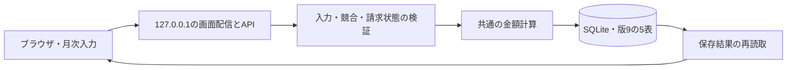

# 請求管理システム 技術構成

版：0.11 S16の年間画面・読取APIを反映　更新日：2026年11月3日

対象は`mvp/3`の作業ツリー。機能・受入条件は[要求仕様書](要求仕様書.md)、物理DBは[ER図とデータ設計](ER図とデータ設計.md)、完了状態とレビュー記録は[仕様管理](仕様管理.md)を参照する。ファイル名は参照継続のため変更しない。

## 1. 実装している構成

| 層 | 使用技術 | 役割 |
|---|---|---|
| 画面 | React・TypeScript | 月次入力、会社別カードと当月の集計、年間集計 |
| ビルド | Vite | distへ配信用ファイルを生成 |
| ローカルAPI | Node.js・Fastify、JavaScript ES modules | 読取・全社保存・入力検証・計算 |
| DB | SQLite、Node標準のnode:sqlite | 版9の5表・46列、同期トランザクション |
| 計算 | src/reward.mjsのBigInt整数演算 | 十進数の時間・単価・率を誤差なく計算し、合意した箇所で丸める |
| 月次集計 | src/summary.mjs・src/MonthlySummary.tsx | 入力中の会社別・全社内訳とステータス。追加の保存先はない |
| 入力検証 | src/month.mjs・src/reward.mjs、server/app.mjs | 画面の保存前検証とAPIでの再検証 |
| 検証 | Vitest、モックはnode:test | 計算・DB/API・期間切替・移行復元・表示用の出力 |

Node.js 24以上。実際の依存版はpackage.jsonとpackage-lock.jsonが基準。ORM・decimal.js・JSON Schema・Playwrightは導入していない。ブラウザでの操作確認とモックの回帰テストは別の検証である。

年間集計は`annual.html`と`src/annual-main.tsx`をViteの追加エントリとして配信する。`GET /api/annual/:year`は既存DBの12か月を一つの読取トランザクションで取得し、`src/annual.mjs`から既存の月次集計を呼んで月別・年合計を生成する。登録済み請求の有無を未登録と0円の区別に用いる。年選択・履歴・非同期応答の世代管理は`src/annual-session.mjs`、表示は`src/AnnualSummary.tsx`が担当する。会社名・月別/年間請求額のソートは`sortAnnualCompanies`でコピーを並び替え、選択列と方向はAnnualTableの画面内状態とする。DBや会社マスタの順序は変更しない。S16の本番画面レビューは待機中。

## 2. 通常起動と保存

`npm run build`の後`npm start`で127.0.0.1:8787に画面とAPIを配信する。PORTでポート、INVOICE_DB_PATHでDBを変更できる。保存先の既定値は.local-data/invoice.sqlite。既知のdistファイルだけを配信する。自動でブラウザを起動する処理はない。

APIはHostを検証し、変更要求にはOriginとx-invoice-request=1を要求する。Cache-Controlはno-store。業務値・認証情報をログへ出さず、予期しないエラーは内部情報を含まない文言にする。LAN公開・複数端末での共同編集は初期範囲外。

## 3. APIと画面の状態

`GET/PUT /api/month/:year/:month`でcompanies配列を扱う。会社はid・name・revision・rows・invoiced・paid・withholdingAmount・visibleを持つ。rowsはid・description・amount、rewardType、hours・rate・manualAmount、priceMode・feePriceMode・travelPriceMode、discountEnabled・discountRate・withholdingEnabledを持つ。対応する物理列はDB資料を参照する。

src/session.mjsが対象年月・編集開始時の入力・保存済み基準・処理中状態を保持し、src/period-url.mjsのPeriodSessionがURLの初期読取・正規化と履歴移動を接続する。月切替は読取成功後に確定し、未保存では保存・破棄・中止を選ぶ。APIへ対象年月を明示し、保存失敗時は元入力を残す。ブラウザのキャッシュ・localStorageは正本にせず、URLはyear・monthクエリで対象年月だけを保持する。初回読取成功時はreplaceState、画面の月切替成功時はpushStateを使う。popstateでは元の履歴位置へ戻して既存の未保存確認と読取を行い、成功後に目的の履歴位置へ進める。再読込後も履歴の位置識別子を引き継ぐ。未保存入力は履歴へ保存しない。

全会社の入力を検証し、会社のversionとrevisionで競合を検出する。同名の会社・業務はIDで分け、他社・別月の明細流用や会社の省略を拒否する。全社保存を1トランザクションで実行し、一部保存はしない。請求済のまま明細・条件・源泉額を変更する要求も拒否する。

src/previous-month.mjsが前月報酬コピーを担当する。既存GETから同じ会社IDの案件単価・時給を読み取り、全明細に新IDを発行して編集中の入力へ反映する。交通費・立替経費・月別源泉額・チェックは引き継がない。読取中はsession.busyで編集・年月切替・保存・連続操作を止め、失敗時は入力と対象月・URLを保持する。既存の全社PUTで保存するため、新規API・DB変更はない。

src/detail-actions.mjsが会社ID・明細IDを指定した行削除を担当する。請求済・入金済・処理中を拒否し、入力から指定行だけを除く。src/DetailActions.tsxは明細行がある場合にコピー欄全体を描画せず、行ごとのゴミ箱の読み上げ名と無効状態を設定する。保存は既存PUTを使い、新規API・DB列は追加しない。

S31のsrc/company-visibility.mjsは表示判定・前月表示設定コピーを、src/CompanyManager.tsxはモーダル内の選択・追加を担当する。コピーは既存GETを使い、失敗時はモーダルの選択と全社の入力を保持する。前月の明細・金額はコピーしない。全社PUTのvisibleをclient_month_visibilityへ保存し、入力のある会社の非表示は画面とAPIで拒否する。

S35ではAppHeader・PeriodControl・CompanyAmountsで画面の見出し・年月操作・カード内訳を共通化する。presentation.mjsは表示用の10内訳・税抜合計＋消費税の税込金額・値引きの負号と前後5年の候補を扱う。計算とAPIの値引き額は正のままで、表示時だけ控除の符号を付ける。style.cssは月次・共通UI、annual.cssは年間表を担当し、端末の配色設定に対応する。保存・読取・競合検出・URL履歴・DB版9は維持する。仕様は要求仕様書§23、状態は仕様管理S35を参照する。

## 4. 金額とチェック

時給は明細単位で円未満切り上げ、税は会社・月の区分別合算後に切り捨て、値引きは同率の税込換算した報酬を合算後に切り捨てる。計算式の正本は要求仕様書§3.1。通貨は円単位INTEGER、時間・単価・率は入力した十進数TEXTで、REALや分単位への換算は使わない。

invoices.total_yenは税・値引き後に調整明細の合計を加減した、源泉控除前の小計。源泉額はMFで計算した会社・月の手入力値で、明細のチェックから自動計算しない。画面の請求額は小計−源泉額で、追加の保存列を持たない。月次集計は編集中の入力から会社ごとの丸め後の額を合算する。MonthlySummaryは請求額が0円の会社行だけを描画から除外する（S29）。全社合計は除外前の全会社から計算し、負額・入力確認の会社行と合計行は残す。入力データ・保存処理・API・DB構造は表示条件で変更しない。

請求済・入金済は独立した列で、入金済には請求済を必要とする。MF消し込み済や作成更新日時・JSONの条件列は現行にない。更新競合には会社のversionを使う。

## 5. DB移行・退避・復元

server/migrations.mjsが001〜009を順に適用して版9を構築する。既存版1〜8はintegrity_check・foreign_key_check、VACUUM INTOによる退避、全表・全列の比較後、未適用分をトランザクションで適用する。接続ではforeign_keys=ON・journal_mode=WAL・busy_timeout=3000を設定する。失敗時はロールバックして起動を中止する。版9への重複適用、対応外・無版の既存DBの自動変更は行わない。

restoreSnapshotは退避を読み取り専用で検査し、既存ファイルを上書きせず新しい復元先へコピーして照合する。具体的な操作は[DB移行と復元](DB移行と復元.md)。この内部保全処理は未実装のS20と区別する。

## 6. 未実装の構成と確認事項

スプレッドシートへの書出し・復元、条件マスタ・国保年金、会社の共通表示順の保存、MF消し込み済、複数画面の引継ぎは要求仕様書§18の範囲。URL年月保持・履歴移動は§12のコード反映済みの範囲。ユーザーレビュー状況は仕様管理を参照する。将来の論理案はDB資料末尾で保持し、現在の物理構成へ混ぜない。S18の長期未取引先の追加判定・全期間共通の非表示とS25の日別稼働・時間／分入力はユーザー指示で対象外とし、会社の表示は現行S31の月別設定を使う。

バックアップ方式は[未実装の方式案](バックアップ復元仕様.md)。保存先・認証・頻度・世代数、対応OSと配布形式、条件履歴の具体化は着手前に確認する。MFと銀行の作業は利用者が外部で行い、API同期・期限通知・添付管理を追加しない。

## 公開用スナップショット

2026年11月3日、公開用に名称と内部の識別子を一般化した。パッケージ名は`invoice-management-tool`、保存先の設定は`INVOICE_DB_PATH`、既定値は`.local-data/invoice.sqlite`、変更要求ヘッダーは`x-invoice-request: 1`、履歴状態のキーは`__invoicePeriod`。DB構造と金額計算は開発版と同じ。元のDB・作業ツリーは変更せず、既存データの自動取込みや旧識別子への互換処理は追加しない。
