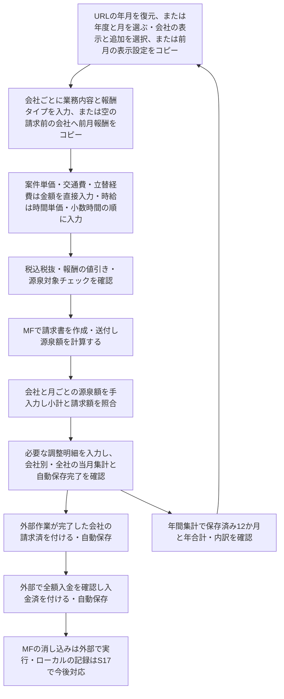

# 個人事業主向け請求管理システム 業務フロー

バージョン：0.16 自動保存と明細操作を反映　更新日：2026年11月23日

対象は`codex/release/0.2.0`作業ツリーの月次入力・保存・集計と年間集計。仕様本文は[要求仕様書](要求仕様書.md)、レビュー状況は[仕様管理](仕様管理.md)を参照する。[月次請求の図](月次請求フロー.svg)は以下の現行フローに対応する。未実装の操作は末尾へ分ける。

## 1. 現行の月次請求

初回は有効なURLの年月を開き、指定なし・不正なら端末の当月を開く（S23・要求仕様書§12）。会社は共通マスタで、明細・請求・源泉額・チェックは選択月へ保存する。空月は全社非表示から始め、「会社の表示・追加」で選んだ会社を表示する。前月やりとりのあった会社を表示する操作は、前月の表示ON/OFFだけをコピーする。当月の入力がある会社は表示を維持し、明細・金額・源泉額・チェックはコピーしない。新規会社は当月に表示し、空行を1行用意する。モーダルの反映後に全社分を自動保存し、キャンセル・Escでは選択と追加を破棄する。案件名・業務タイプ・件数入力はなく、件数分の報酬も案件単価で合計額を直接入力する。

調整明細は業務内容と符号付き金額を入力し、税・値引き・源泉の対象外として小計へ加減する。元の報酬・単価・時間は変えない。

時給は時間×単価を十進数で計算して明細ごとに円未満切り上げ。税は会社・月の区分別合算後、値引きは税込換算した同率の報酬を合算後に切り捨てる。交通費・立替経費は値引き・源泉チェックの対象外。報酬へ戻したときの以前の条件は保持する。明細に合わせて源泉額を自動変更しない。

会社見出しと下の集計表で、小計（税・値引き後に調整額を加減、源泉控除前）、手入力源泉額、請求額（小計−源泉額）を確認する。集計表では請求額0円の会社行を非表示にし、入力に応じて再表示する。負額・入力確認の行と全社合計は表示する。会社カードと保存データを保持し、非表示会社も全社の各内訳へ合算する（S29・要求仕様書§16.1）。全社の値は各社で丸めた額の合算。実際の銀行入金額とは区別し、請求済・入金済でも予定額を変えない。

明細0行の会社カードに表示する「前月からコピー」は、同じ会社の保存済み前月報酬だけを新しい明細IDで入力へ追加する。1月は前年12月を参照する。コピー先に明細・途中入力がある場合や請求済・入金済の場合は実行しない。交通費・立替経費・月別源泉額・請求と入金のチェックは引き継がず、元月・他社・コピー先の源泉額を保持する。コピー後の入力・編集も全社分を自動保存する。読取失敗では入力と対象月を保持し、再試行できる。

各明細の右端のゴミ箱は指定した1行を入力から削除し、行番号・会社別と全社の集計を更新する。請求済・入金済・処理中は削除できない。削除は全社の自動保存で確定する。明細行がある間は前月コピーの操作欄全体を隠し、最後の行を削除すると再表示する。未保存で月切替を破棄すれば、保存済みの明細へ戻る。

明細の番号の横のつまみをドラッグ＆ドロップすると、同じ会社・月の行を任意の位置へ移動し、自動保存する（S36）。つかんだ明細行の内容が浮き上がってカーソル・指へ追従し、元位置を薄く残す。移動先は線で示す。入力領域内で表の上へはみ出した場合は先頭、下へはみ出した場合は末尾へ移動する。Esc・左右の範囲外・別会社へのドロップは中止する。浮いた表示は操作終了で消える。タッチとつまみの上下キーにも対応する。請求済・入金済・処理中と範囲外の移動は止める。時給欄は単価→時間の順に入力し、横スクロールバーは表下の余白に収める。

別タブの保存は最新データを読み直し、未編集なら自動反映する（S38）。未保存の入力がある場合は警告して自動保存を止める。最新データの読込みは未保存入力の破棄を確認し、中止・通信失敗では入力を保持する。前面復帰時にも確認する。

## 2. 全社保存と年月切替

入力後に約600ms操作が止まると、非表示会社を含む全社の入力と表示設定を自動保存する（S37）。下端には保存状態を表示し、通常の保存ボタンを置かない。保存中の追加入力を保持して次の保存へ回す。空行は保存せず、途中行・不正値・競合は全社の保存を止める。失敗後も元の年月・全社の入力を保持して再試行できる。保存後は月切替・再読込・再起動でも内容と条件・集計が戻る。

画面名は「請求管理ツール」。見出し横で年の直接入力または前後5年の選択を行い、月は左右の矢印で切り替える（S35）。月次カードと年間の内訳は同じ項目・順番を使い、税込金額を含め、値引き額は表示時だけマイナス表記とする。

年月・画面切替では保存完了を待ち、有効な入力を保存してから移動する。入力不備・失敗では保存・破棄・中止を選ぶ。読取成功まで元月を保持し、保存先を切替先へ変えない。空月を開くだけで書き込まず、同じ会社・業務の複製もしない。URLはyear・monthクエリで対象年月を保持し、再読み込み後も同じ年月を表示する。画面の月切替成功で履歴を追加し、ブラウザの戻る・進むでも月を移動する。未保存なら元の履歴位置へ戻して同じ確認を行い、切替成功後だけ目的の位置へ進める。中止・失敗は元のURL・年月・入力を維持する。

年間集計は月次画面の「年間集計」から同じ年で開く。未保存なら保存・破棄・中止を選び、保存失敗は元入力を保持して移動しない。年間画面は会社名昇順で開き、会社名・各月・年合計の見出しで昇順/降順を切り替える。内訳は会社と一緒に移動し、全社合計は末尾に固定する。状態アイコン付きの請求額を初期表示し、会社別・全社合計の内訳を開閉する。会社別の月別金額から既存の対象年月の月次入力へ移り、戻る操作で対象年へ復帰する。各月の保存済み金額を合算し、入金済や会社の表示設定で除外しない。年合計請求額が0円の会社行と内訳は年間一覧で非表示にするが、全社合計への合算と保存データは維持する。年間読取ではDBへ書き込まない（S16・要求仕様書§22、本番画面レビュー待ち）。

## 3. 作業チェックと訂正

請求済→入金済の順に付ける。入金済の間は請求済を外せない。請求済は青、入金済はグレーを優先し、状態ラベルも表示する。請求済以降は明細・条件・源泉額の編集と追加を止めるが、訂正用のチェックは操作できる。

訂正が必要な場合は外部の状態を確認し、入金済→請求済の順に外して内容を直す。旧版の未請求・入金済は要確認として利用者が訂正する。チェックを自動で補正したり、外部サービスの作業完了を推定したりしない。分割・合算・手数料・過不足・返金、銀行入金日等の管理は追加しない。

## 4. 保全と実データの扱い

DB更新時には整合性を確認した退避を作り、移行失敗時は旧構造へ戻して起動を止める。[移行・復元手順](DB移行と復元.md)に従う。通常の実データ利用前には、フォルダ選択によるJSONバックアップ・復元（S20・要求仕様書§24）の検証とレビューを完了する。最新の保存日時とフォルダ名／ファイル名を画面に表示する。Google Drive同期はPCのDriveアプリが担当する。参考表は参照専用で、指定の試し入力は隔離DBへ行う。実データ・比較記録・DBをGitへ入れない。

## 5. 未実装の後続フロー

| 管理ID | 今後の操作・確認 |
|---|---|
| S17 | MFで消し込み完了後のローカルチェック |
| S22 | 会社の共通表示順。操作や初期順は着手前に確認 |
| S19 | 国保・年金の種類・年月・支払額・メモと年合計。納付予定や控除配分は追加しない |
| S20 | 要求仕様書§24のコード反映済み・本番レビュー待ち。月次・年間から専用画面へ移動し、PCのフォルダへ日時付きJSONを保存して日時と場所の履歴を記録し、保存・復元の操作欄の下へ新しい順で表示。月次の未保存変更は保存・破棄・中止で確認。復元はファイル選択・一時DB検証・内容確認・現在DB退避後の全件切替。Google設定不要。Drive同期・別PC実機は未検証 |
| S21 | 対象年・正本を指定した旧表移行。明細と集計を分け、空欄・チェックを推測しない |
| S26 | 別画面への年月・未保存入力の引継ぎ。月次入力内のURL復元と履歴移動はS23でコード反映済み |
| S24 | 条件履歴・適用期間。標準条件の採用や適用日の基準は着手前に確認 |

会社の表示・非表示は現行の月別設定S31を使う。S18の長期未取引先の追加判定・全期間共通の非表示とS25の日別稼働・時間／分入力は、2026-11-02のユーザー指示で対象外とした。年間と月次の往復はS16に含め、S26の残りの画面間引継ぎはS19等の追加画面で検証する。

後続機能の操作・画面・データへの影響を提示し、明示の了承を得てから仕様詳細化・テスト・実装へ進む。未実装の枠やテーブルを全体案にあるという理由だけで先行追加しない。

[月次請求フロー](月次請求フロー.svg)は本書§1に対応する補助図。編集元は`docs/diagrams/monthly-flow.dot`、再生成は`dot -Tsvg docs/diagrams/monthly-flow.dot -o docs/月次請求フロー.svg`。
